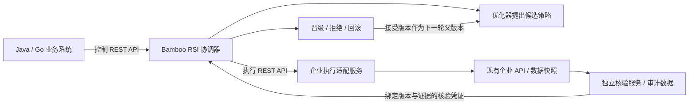

# Bamboo RSI HTTP

让 Java、Go、.NET 等系统通过 HTTP/JSON 接入现有 RSI 协调器。业务调用方无需安装 Python；RSI 服务端运行 `rsi-core`、`rsi-sdk` 和本包。MIT，Python 服务端 3.11+，运行依赖不增加 Web 框架。

首版提供两组接口：

| 接口 | 谁提供 | 用途 |
| --- | --- | --- |
| 企业任务接口 `/rsi/v1/*` | 企业的薄适配服务 | 读取任务与数据快照、按候选策略调用业务 API、返回独立核验凭证 |
| RSI 控制接口 `/v1/*` | Bamboo RSI 服务 | 注册实验、生成候选、执行评测、查询预算和版本、晋级、回滚、停止与恢复 |

已有企业 API 可以保留原来的 Java/Go 实现与返回格式。薄适配服务负责字段映射、数据快照和结果核验；如果已有接口符合本协议，就可以直接接入。只有读取权限时，先做只读流程或影子评测。模型必须有可修改的策略、明确的目标和独立效果核验，才会形成优化闭环；配置一个业务 URL 不会自动产生可靠的 RSI。



## 已提供的能力

- 任务清单包含目标、可优化文件、主/辅助指标、样本、来源、预算以及执行器/核验器/数据集版本；启动前固定清单哈希。
- 复用 SDK 的双次构建、独立评测、内容寻址版本、CAS 晋级和父版本继承。HTTP 服务不改写游戏协调器，也不缩减它们的验收要求。
- 控制操作返回 `202 + operation id`，通过查询操作结果确认完成。持久幂等键避免因 HTTP 响应丢失而重复执行；冲突请求返回 409。
- 执行前记账，失败不返还预算；宿主重启将结果未知的操作记为 `interrupted`，不会自动重新执行。
- 独立核验服务通过 HMAC-SHA256 签署原始证据的判定；后续核验旧版本只读本地凭证，不重发业务请求，也不让裁判改判旧证据。
- 凭据只通过进程环境变量注入；不放在业务配置、候选文件、模型上下文或请求日志中。请求不自动重试、不跟随重定向；有响应大小和时间上限。
- 提供 [OpenAPI 3.1](openapi.json)、[协议说明](PROTOCOL.md)、[Java 客户端](examples/java/RsiClient.java) 和 [Go 客户端](examples/go/main.go)。控制与企业适配接口都可以按 OpenAPI 生成类型或服务骨架。

## 先运行完整的 HTTP 示例

在仓库根目录创建独立环境，避免修改已有游戏依赖：

```powershell
py -3.11 -m venv .runtime/http-venv
.runtime/http-venv/Scripts/python.exe -m pip install -e ./rsi-core -e ./rsi-sdk -e ./rsi-http
.runtime/http-venv/Scripts/bamboo-rsi-http.exe demo-http --destination .runtime/http-catalog-demo
```

演示实际启动三个仅监听本机的 HTTP 服务：RSI 控制、任务执行/商品查询、独立核验。它通过控制 API 发起操作，执行父版本逐条查询与候选批量查询，对比结果和业务读取审计，完成晋级、下一轮继承、幂等重试与回滚。程序结束会关闭全部示例服务。

示例的三个验证任务，父版本读取业务 API 共 12 次，候选共 3 次，逐条结果保持一致。数据是制造的本地库存样例，候选由脚本通过 API 提供，`real_model_calls: 0`、`real_business_acceptance: false`、`scope: offline_reference` 写入报告。下一轮继承后返回 `no_change`，不表示又产生了一次改进。它验证跨服务工程流程，不是企业生产效果或自主模型能力的证明。

报告为 `<destination>/demo-report.json`。`secrets.json` 只包含随机生成的本机演示凭据，供复核历史凭证使用，必须留在私有演示目录；不是任何实际企业账号。重复运行必须用新的目录，旧证据不覆盖。

## 对接企业接口

1. 定义一个有边界的任务，例如“准确读取指定库存，并减少 HTTP 调用数”，确定允许改变的是批次大小、路由、缓存策略、提示词或工作流配置。首版远程桥接不编译或任意执行模型生成代码。
2. 企业服务实现 `GET /rsi/v1/manifest`、`POST /rsi/v1/execute`，独立核验服务实现 `POST /rsi/v1/verify`。可参考 [实际执行与审计示例](src/bamboo_rsi_http/reference.py)，按 OpenAPI 在 Java/Go 中实现相同接口。
3. 用 `inspect` 获取清单和哈希，审核其任务/样本/指标，再填入 [catalog.example.json](examples/catalog.example.json)。示例中的域名和哈希占位符不能直接执行。
4. 运行控制服务，由 Java/Go 或现有任务调度器调用它。一个任务可以分步采样；生产发布仍由业务的发布系统处理。

`inspect` 的配置仅为一个 endpoint 对象，例如 `{"base_url":"https://rsi-reader.example.com","token_env":"RSI_READER_TOKEN"}`。配置文件放私有目录，凭据由你自己的密钥系统注入对应环境变量，不要把密钥填入 JSON。

```powershell
bamboo-rsi-http inspect --endpoint-config .runtime/reader-endpoint.json --output .runtime/reader-manifest.json
bamboo-rsi-http check --config .runtime/inventory-integration.json
bamboo-rsi-http serve --catalog .runtime/enterprise-catalog.json --home .runtime/enterprise-rsi --token-env RSI_CONTROL_TOKEN
```

`check` 使用 catalog 中单个 integration 对象；`serve` 使用完整 catalog。执行端令牌、核验端令牌、核验签名密钥与控制令牌是独立的凭据。签名密钥至少 32 个可打印 ASCII 字符，只有独立核验服务和 RSI 验证端持有。令牌至少 16 字符，控制令牌至少 32 字符。

已有业务系统配置不同任务时，注册不同 `task_id`。服务注册来自运维侧的 catalog，控制请求不能临时指定网络地址、读取本机路径或执行 shell 命令。一个服务实例对应一个可信操作权限域。

## Java / Go 调用

设置进程环境变量 `RSI_CONTROL_TOKEN`。下面 `request-create-0001` 是请求幂等键，不是令牌；同一个请求在响应丢失后必须使用原键，不能每次自动生成新键。

```powershell
# Java 11+，可直接以源文件模式运行，也可编译进现有项目。
java rsi-http/examples/java/RsiClient.java http://127.0.0.1:8079 GET /v1/integrations
java rsi-http/examples/java/RsiClient.java http://127.0.0.1:8079 POST /v1/experiments rsi-http/examples/create-experiment.json request-create-0001

# Go，无第三方依赖。
go run rsi-http/examples/go/main.go http://127.0.0.1:8079 GET /v1/integrations
go run rsi-http/examples/go/main.go http://127.0.0.1:8079 POST /v1/experiments rsi-http/examples/create-experiment.json request-create-0002
```

返回的 `id` 是操作 ID；轮询 `/v1/operations/{id}`，直到 `succeeded`、`failed` 或 `interrupted`。不要把收到 202 当成任务已完成。示例请求的集成 ID 需要与私有 catalog 一致。

实验动作发送到 `/v1/experiments/{experiment}/actions`：

| operation | 附加字段 | 行为 |
| --- | --- | --- |
| `prepare` | 可选 `proposal` | 登记样本、生成/接收候选、可重现构建 |
| `advance` | `job` | 执行一个已登记的父/候选槽位 |
| `finish` | `job` | 重验完整证据，晋级或拒绝 |
| `step` | 可选 `proposal` | 在本次操作中完成 prepare/advance/finish |
| `recover` | `job` | 保留失败/中断证据，处理结果未知状态 |
| `rollback` | `expected_version`, `reason` | 校验当前版本后回到父版本；保留旧证据 |
| `stop` | 无 | 立即记录 STOP，下一个检查点停止 |
| `resume` | 无 | 清除 STOP；不重发未知执行 |

省略 `proposal` 时使用 catalog 配置的 Codex 优化后端；提供 `proposal` 时使用外部优化器的结构化替换，操作结果明确记录 `api_supplied`，不声称它由本系统自主生成。只允许改任务契约列出的文件，不能改核验器或放宽指标。

## 首版部署边界

内置服务只绑定 loopback；跨机器 Java/Go 服务通过企业现有 HTTPS 反向代理或 API 网关接入。反向代理负责 TLS、连接/请求限额、统一身份及组织审计。当前协调器串行处理一个执行操作，忙时返回 409，停止请求仍可受理；它没有宣称提供多租户隔离、组织级总配额或高可用分布式调度。

只读和影子模式由业务执行服务落实。新建实验不是绕过组织预算的方法，跨实验配额要由企业调度层控制。晋级更新实验的接受版本，不自动向生产发布、不执行扣款或退款。非重复性业务与长期线上 A/B 需要专门的采样和统计设计，不能套用默认三对样本就声称验收。

清单、实现、数据集、HTTP 接入配置或签名信任密钥变更需要新实验；原实验仍用原版本核验。保留旧核验信任材料才能离线复核旧凭证。HMAC 证明受信任核验服务签过某个判定，不能代替该服务实际读取真实结果和审计数据。

## 验证

```powershell
platform/.venv/Scripts/python.exe -m pytest rsi-http/tests -q -c rsi-http/pyproject.toml
```

包含真实 loopback HTTP 对照、核验失败、签名/版本错配、超时不重试、凭据边界、幂等冲突、重启未知结果、停止和回滚测试。Java/Go 测试会编译两个原生客户端，再各自通过 HTTP 完成晋级、继承和回滚；本机缺工具链时明确跳过，CI 会安装两种工具链并执行。既有 SDK/核心文件保持不变，HTTP 层在独立包中开发。
